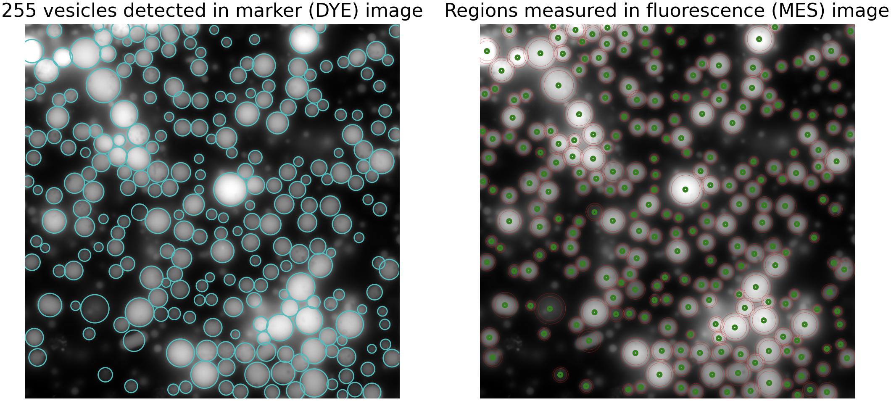
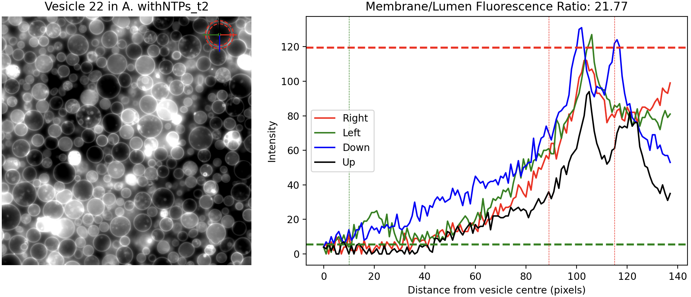
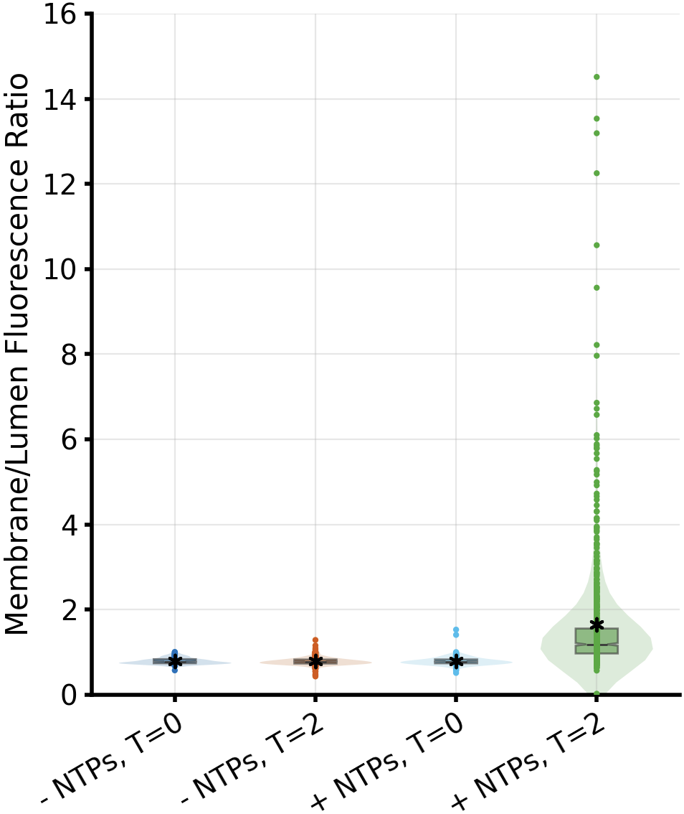
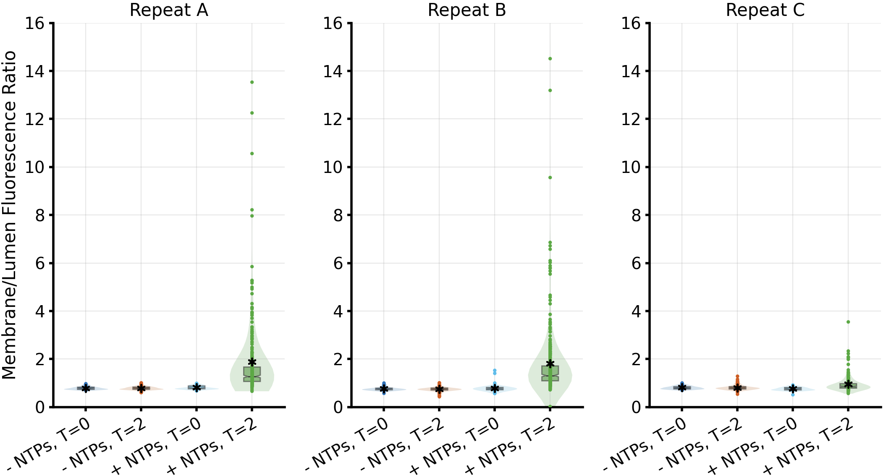

# Vesicle Image Analysis (Python)


Automated detection of giant unilamellar vesicles (GUVs) in fluorescence microscope images, with per-vesicle measurement of whole-vesicle or membrane-localised fluorescence.

The pipeline finds every vesicle in a marker dye image, measures the fluorescence of each one in a second channel, and compares conditions using:
- per-vesicle violin plots (violin, data points, box, median notch and mean) for all repeats pooled, and for each biological repeat side by side
- tables of the number of vesicles and the mean & median fluorescence for each condition and each image
- for membrane/lumen ratios, the number and percentage of localised vesicles (ratio > 1)

It is a Python version of the MATLAB GUV analysis scripts used in the following publications: [Dack et al. 2026. ACS Synth Biol](https://pubs.acs.org/asbcd6/article-pdf/doi/10.1021/acssynbio.6c00626/68816317/sb6c00626.pdf) and [Bradic et al. 2026. ChemRxiv](https://chemrxiv.org/doi/full/10.26434/chemrxiv.15010597/v1). In this version, Cellpose deep learning segmentation is available as an alternative detection method.

Developed by Chelsea Dack (chelsea.dack.24@ucl.ac.uk), PhD student in the [Booth group](https://boothlab.uk/).

## In Development

- Additional detection method (Watershed segmentation) to improve computationally-light detection.
- Unit tests.
- Non-programmer-friendly interface.

## Step 1. Vesicle Detection

Vesicles are detected in the marker dye (`_DYE`) image, using one of two methods (`detection_method`):

- **`'HOUGH'`:** a circular Hough transform. It re-implements MATLAB's `imfindcircles(image, radiusRange, 'Sensitivity', s)` (see `Functions/matlab_helpers.py`). This detection approach needs to be optimised for your images manually. It struggles with densely populated or messy images and membrane-localised fluorescent dye markers, but is light-weight, quick, and uses precise parameters.
     - **How it works:** It uses a circular hough transformation. It finds an edge then predicts where the centre of the circle is, using the radii range that you define. It then choses the points with the highest number of “votes” as circle centers. You can change the sensitivity for 0=perfect circle and 1=more noise.
- **`'CELLPOSE'`:** [Cellpose](https://github.com/MouseLand/cellpose) segmentation. It is a deep-learning model. It is better for densely populated or messy images and membrane-localised fluorescent dye markers, but it requires download of the model, is computationally more intensive, and is slower (about 1 minute per image), so its results are saved in a `Saved vesicle labels` folder inside the working folder and reused. If an image changes, it is detected again automatically.
   - **How it works:** For every pixel, it assigns a 'cell probability score', then, if it is predicted to be in a cell, it a calculates a vector flow field for which way is the center of the cell. It uses ODE tracking to determine where most pixels meet if they follow along those vectors. Pixels that converge at the same connected spine/centre are grouped. It can be case-by-case trained for better detection. Compared to simpler models, like U-Net which tries to predict a binary mask, boundaries can be detected better. 

Both methods only keep vesicles between `min_diameter_micron` and `max_diameter_micron`.

Each image is only detected once. The test, the measurement and the check figures all use the same detected vesicles.

Detection can be validated for individual images using `func_test_detection_vesicle`:
'

## Step 2. Fluorescence Measurement

The fluorescence (`_MES`) image is measured in one of three ways (`measure_fluorescence_type`):

| Type | Measurement | Use Example | Normalisation |
|---|---|---|---|
| `'WHOLE'` | Mean fluorescence inside the vesicle | GFP expression levels | minus the mean of the `_Background` image |
| `'MEMBRANE-BACKGROUND'` | Membrane fluorescence (see below) | Recruitment to outer vesicle surface | minus the mean of the `_Background` image |
| `'MEMBRANE-INNER'` | Membrane fluorescence (see below) | Recruitment to inner vesicle surface | divided by the mean of a 10 pixel radius circle at the vesicle centre (membrane/lumen ratio). No background image is needed. |

**Membrane fluorescence:** 4 line profiles (right, left, down, up) are taken from the vesicle centre out to 1.3 × the radius. The peak of each is found between `inner_boundary` × radius and `outer_boundary` × radius, where the membrane should be. The highest and lowest of the 4 peaks are removed and the 2 middle values are averaged.
- Line profile measurement can be validated for individual vesicles using `func_line_profile_vesicle`:
'

**Removed vesicles (`'MEMBRANE-INNER'` only):** vesicles with a completely dark centre (division by 0), or a ratio above `max_ratio` (default 30), are removed from all results. A near-black lumen gives a meaningless, extreme ratio (hundreds to thousands), while real, strongly localised vesicles in the test dataset reached ratios of about 26. The number removed is printed.

Calculated fluorescence values can be validated for individual images using `func_plot_MES_for_sample_vesicle`:
'

## Step 3. Violin Plots

Violin plots visualise the measured fluorescence values for individual vesicles, viewed either as a pooled population or as individual repeats:
'
'

## Data Format

The images are kept in a separate working folder, with one folder per condition:

```
working_folder/
├── noNTPs_t0/                          # one folder per condition
│   ├── A. noNTPs_t0_DYE.png            # repeat A, marker dye (used for detection)
│   ├── A. noNTPs_t0_MES.png            # repeat A, fluorescence to measure
│   ├── A. noNTPs_t0_Background.png     # repeat A, negative background (not needed for 'MEMBRANE-INNER')
│   ├── B. noNTPs_t0_DYE.png
│   └── ...
├── noNTPs_t2/
├── withNTPs_t0/
└── withNTPs_t2/
```

- The images can be colour or greyscale `.png` files (8 or 16 bit).
- Images are named `repeat. condition`. The text before the first `.` is the biological repeat.
- The condition folder names are used as the graph labels (these can be changed in the notebook).
- Set `pixel_size_micron` in the first cell to match your microscope (default: 124.5 µm across 1920 pixels), as the vesicle diameter limits are given in microns.

## How to run

1. Requirements: Python 3.10 or later. Install the packages once with:
   ```
   pip install numpy scipy scikit-image matplotlib pandas pillow seaborn ipykernel ipympl
   ```
   To use Cellpose detection, also install `pip install cellpose` (it uses the GPU if there is one, including Apple silicon).  
   Tested with Python 3.13, numpy 2.4, scipy 1.17, scikit-image 0.26, matplotlib 3.10, pandas 3.0, seaborn 0.13 and Cellpose 4.2, in VS Code on macOS.
2. Open `MAIN_SCRIPT_VESICLE.ipynb` in VS Code (or Jupyter) and choose the Python environment as the kernel.
3. In the first cell, set `working_folder` to the folder containing your condition folders (a full path, or a path relative to the notebook's folder). The `Functions` folder is found automatically.
4. Run the cells in order (Shift + Enter):
   1. **Input parameters:** the conditions, measurement type, detection method and settings.
   2. **Test parameters:** check the detection and the measured regions on one image, and adjust the settings if needed.
   3. **Detect & measure:** processes every image, giving the `vesicleData` table (one row per vesicle). Re-run this whenever you change the input parameters. The check figures give an error if you forget.
   4. **Summary tables:** number, mean, median and % localised vesicles for each condition (repeats pooled) and each image.
   5. **Violin plots:** all repeats pooled, then each repeat side by side. The y axis limits can be lowered to hide sparse high values. They are still included in the violins and means, and the number hidden is printed.
   6. **Check measured fluorescence:** colours and numbers each vesicle in one image by its measured value.
   7. **Check line profiles:** the line profiles of one numbered vesicle, with the membrane search region and the averages used.

Figures are interactive (zoom and pan, like MATLAB figures) using `ipympl`. Change `%matplotlib widget` to `%matplotlib inline` in the first cell for static images. Tables and figures can be saved with the commented lines in each cell.

## Acknowledgements

Cellpose: Stringer, C., Wang, T., Michaelos, M. & Pachitariu, M. Cellpose: a generalist algorithm for cellular segmentation. *Nature Methods* 18, 100–106 (2021).
